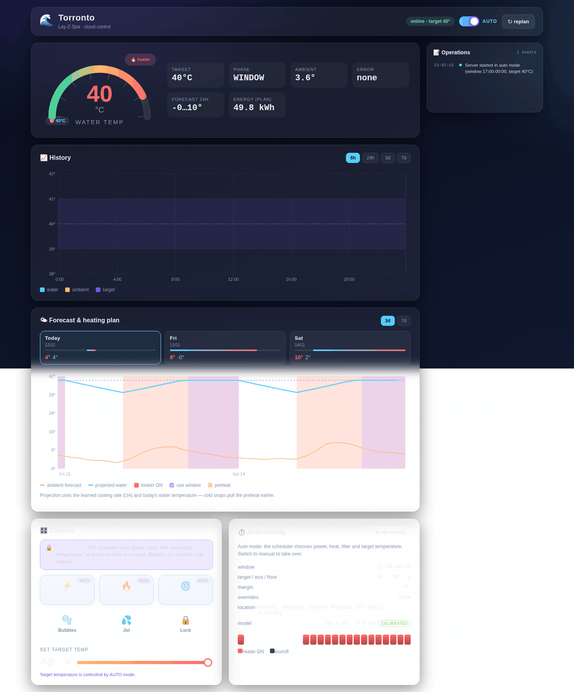
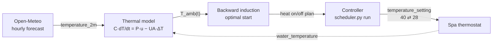
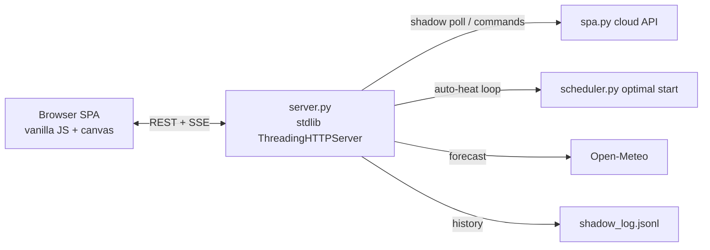
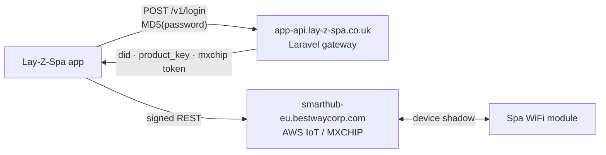

<div align="center">

# 🌊 torronto

**Lay-Z-Spa · cloud read/write control from the command line**

Unofficial protocol notes for the **Lay-Z-Spa Toronto AirJet Plus (UltraFit)**,
worked out from the app's traffic — hopefully useful to others doing the same.

[](https://www.python.org)
[-brightgreen)](#)
[](https://github.com/kipz/lazy-spa-torronto/actions/workflows/ci.yml)
[](#)
[](#)
[](#)
[](#license)

<br>

**Live dashboard — gauge, history, forecast & the optimal-start heating plan.**  
The scheduler measures the tub's real cooling rate overnight and tightens preheat timing on its own.

<a href="docs/torronto-demo.gif">
  
</a>

</div>

---

## ✨ Highlights

| | |
|---|---|
| 🧪 **Unofficial** | Login route, MD5 password quirk, signing scheme — inferred from `libapp.so` |
| ⌨️ **Full control** | Power, heat, filter, AirJet, HydroJet, lock, target temp |
| 🌡️ **Smart heating** | Weather-aware scheduler preheats to 40 °C by window start, kWh-optimised |
| 🕸️ **Web UI** | Zero-dep single-page app: live gauge, history chart, 3–7 day forecast & heating-plan chart, full controls, auto-heat |
| 🧩 **Zero dependencies** | Pure Python stdlib, three files (`spa.py` + `scheduler.py` + `server.py`) |
| 🔐 **Cached auth** | Login once, tokens cached — no repeated logins that kill the app session |
| 📡 **Live monitoring** | `watch` polls the cloud shadow and prints on change |

## 🚀 Quick start

```bash
cp secrets.env.example secrets.env   # add your app email + password
python3 spa.py login                 # caches tokens → tokens.json
python3 spa.py status                # live state of the tub
python3 spa.py temp 38               # target temperature
python3 spa.py wave on               # bubbles on 🌊
python3 spa.py watch                 # poll every 15s, print on change
python3 scheduler.py plan            # energy-optimal 48h heating plan (Open-Meteo)
python3 scheduler.py run             # apply it continuously (see SCHEDULER.md)
python3 server.py                    # web UI + API at http://localhost:8080/ (see WEB.md)
```

## 🕹️ Commands

| Command | Effect |
|---|---|
| `login` | (Re)login, cache tokens |
| `status [--raw]` | Current state (JSON with `--raw`) |
| `watch [--raw] [--interval N]` | Poll every 15s, print on change |
| `power on\|off` | Master power |
| `heat on\|off` | Heater |
| `filter on\|off` | Filter pump |
| `wave on\|off` | AirJet bubbles |
| `jet on\|off` | HydroJet (if equipped) |
| `lock on\|off` | Panel lock |
| `temp <20-40>` | Target temperature (spa's unit) |
| `raw <datapoint> <value>` | Arbitrary datapoint write |
| `ota` | Check for published firmware updates |

> 🌡️ Weather-aware heating scheduler — see [below](#-heating-scheduler).

## 🌡️ Heating scheduler

A weather-aware controller that plans *when* the 2 kW heater runs so the tub
hits **TARGET_TEMP (default 40 °C) exactly at the start of each use window**,
while burning as little energy as possible. It uses a free hourly forecast and
a fitted thermal model, and re-plans every hour.



1. **Forecast** — Open-Meteo (free, no key; UKMO model for UK), geocoded from `LOCATION`.
2. **Model** — `C` from 1250 L water, `P` ≈ 2 kW heater, `UA` loss coefficient fitted by `calibrate`.
3. **Optimise** — backward induction finds the **energy-minimal bang-bang policy**: heat at full power as *late as possible*, hold during the window, coast overnight.
4. **Apply** — `run` re-plans hourly and switches `temperature_setting` (40 in-window, 28 eco), letting the spa's own thermostat do the on/off.

<details>
<summary><b>📋 Scheduler reference</b> (click to expand)</summary>

| Command | Effect |
|---|---|
| `scheduler.py plan` | Print the 48 h heater plan (dry run) |
| `scheduler.py plan --simulate` | Offline demo with synthetic weather |
| `scheduler.py run` | Persistent controller (applies to the spa) |
| `scheduler.py run --dry-run` | Log what it would do, touch nothing |
| `scheduler.py calibrate` | Fit `UA`/`P` from `shadow_log.jsonl` + historical weather (the web server also fits `UA` automatically from overnight coast-downs) |
| `scheduler.py selftest` | Physics sanity checks |

**Config** (`scheduler.env`, gitignored):

| Key | Default | Meaning |
|---|---|---|
| `LOCATION` | `London, UK` | City/postcode (geocoded) or `LAT`/`LON` |
| `WINDOW` | `17:00-23:00` | Use window; per-day overrides `WINDOW_SAT`… An end earlier than the start crosses midnight (e.g. `22:00-01:00`). |
| `TARGET_TEMP` | `40` | Setpoint during windows (device clamp: 40) |
| `ECO_TEMP` | `28` | Comfort floor while unused |
| `FLOOR_TEMP` | `8` | Hard floor (freeze protection) |
| `MARGIN` | `0` | Extra °C held above target (sensor offset) |

**Optimality:** for a first-order thermal system with a deadline, holding
temperature costs more than coasting down and reheating — so the minimum-energy
policy is bang-bang, heating as late as possible (the same structure smart
thermostats call "optimal start"). Full derivation in [`SCHEDULER.md`](SCHEDULER.md).
</details>

> [!NOTE]
> **It learns the cooling rate by itself.** Defaults (`UA=0.03 kW/°C`, `P=2 kW`)
> work, but the web server watches real overnight coast-downs, fits `UA` from
> them automatically (rolling median, ≥3 samples, written to
> `scheduler_model.json`), and logs each update. Run `scheduler.py calibrate`
> if you also want to fit heater power from a full heating cycle.

## 🕸️ Web UI

A zero-dependency single-page app for control + visualisation: live
temperature gauge, history chart, every device control, and the auto-heating
scheduler — all in one browser tab. Edit use windows and temperatures from the
UI, follow commands through to confirmation, and watch the live operation log.
No npm, no CDN, no build step.



1. **Serve** — `python3 server.py` → http://localhost:8080/ (binds `0.0.0.0`, config in `web.env`).
2. **Watch** — a poller fetches the shadow every 15 s, appends history, and pushes live updates over SSE.
3. **Control** — every device command (power/heat/filter/bubbles/jet/lock/temp) via the API, with the 40 °C clamp and temp-rejected-in-auto enforced server-side.
4. **Auto-heat** — the Manual ⇄ Auto toggle hands heating to the scheduler (same `scheduler_step` as the CLI); Auto shows the live phase + 24 h heater plan.

<details>
<summary><b>📋 Web API reference</b> (click to expand)</summary>

| Method | Path | Purpose |
|---|---|---|
| GET | `/api/state` | Live shadow + mode + phase + setting |
| GET | `/api/history?range=24` | Water/target/heater/ambient series (6h/24h/3d/7d) |
| GET | `/api/plan` | 48 h optimal-start heater plan + energy |
| GET | `/api/scheduler` | Mode, windows, per-day overrides, target/eco/floor/margin |
| POST | `/api/scheduler` | `{"mode":"auto"\|"manual"}`, `{"replan":true}`, or `{"config":{...}}` |
| GET | `/api/weather` | Next-24 h forecast |
| POST | `/api/cmd` | `{"datapoint","value"}` — clamped, temp rejected in auto |
| GET | `/api/health` | Connectivity, last update age |
| GET | `/api/log?limit=100` | Recent operations (commands, mode/settings changes) |
| GET | `/api/events` | SSE live push (state/plan/mode/config/log) |

Config in `web.env` (gitignored): `BIND`, `PORT`, `MODE`. Full docs in [`WEB.md`](WEB.md).
</details>

> [!CAUTION]
> **No authentication — trusted LAN only.** The server controls a real device.
> Restrict with `BIND=127.0.0.1` or put it behind an authenticated reverse
> proxy; never expose it to the internet.

## 🗺️ How the protocol works



1. **Login** — `POST /v1/login` with the **MD5 hash** of your password (not the password itself — a detail that took a while to pin down).
2. **Identity** — the response carries the spa's `did`, `product_key` and an MXCHIP visitor token.
3. **Data plane** — read via `thing_shadow`, write via `device/command`, every request signed with `sign = UPPERCASE(MD5(appid + appsecret + nonce + ts))`.

<details>
<summary><b>📋 Datapoint reference</b> (click to expand)</summary>

| Datapoint | Read | Write | Meaning |
|---|---|---|---|
| `power_state` | 0/1 | 0/1 | master power |
| `heater_state` | 0–8 | 0/1 | 0 off · 2–3 heating · 4–6 holding · 7–8 winter mode |
| `filter_state` | 0/2 | 0/1 | filter pump (read 2 = running) |
| `wave_state` | 0/1 | 0/1 | AirJet bubbles |
| `hydrojet_state` | 0/1 | 0/1 | HydroJet massage |
| `temperature_setting` | 20–40 | 20–40 | target temp (spa's unit) |
| `temperature_unit` | 1=C, 0=F | – | display unit |
| `water_temperature` | number | – | current water temp |
| `warning` | "1" = at target | – | reached set temperature |
| `error_code` | string | – | pump error code |
| `locked` | 0/1 | 0/1 | panel lock |

Raw registers (`B0–B9`, `P0–P2`, `W0`) remain **undecoded** — a TODO.
</details>

## 🧪 Testing & CI

Zero-dependency `unittest` suite covering the protocol helper (signing, HTTP,
status formatting), the scheduler (windows, weather, thermal model,
optimal-start invariants, calibration, controller phases), and the web server
(API endpoints, command validation, mode switching — all cloud/weather mocked).

```bash
python -m unittest discover -s tests -v   # run the suite
python scheduler.py selftest              # policy sanity checks
```

**CI** (`.github/workflows/ci.yml`) runs every push/PR on **Python 3.8–3.12**:
compile check → unit tests → scheduler selftest → offline simulation. Actions
are pinned to commit SHAs and the workflow runs with `contents: read` only.
See [`SECURITY.md`](SECURITY.md) for the security policy.

## 📚 Documentation

| File | Contents |
|---|---|
| [`PROTOCOL.md`](PROTOCOL.md) | Full protocol spec — endpoints, auth, signing, payloads |
| [`RESEARCH_LOG.md`](RESEARCH_LOG.md) | Chronological RE session log, incl. all dead ends |
| [`SENSOR_HACK.md`](SENSOR_HACK.md) | Engineering deep-dive: beating the 40°C cap |
| [`SCHEDULER.md`](SCHEDULER.md) | Weather-aware heating scheduler: model, optimality, usage |
| [`WEB.md`](WEB.md) | Web server + SPA: features, API, modes, security |
| [`COMMUNITY_POST.md`](COMMUNITY_POST.md) | Ready-to-paste writeup for issue #88 |
| [`docs/datapoints-FTEW0E.json`](docs/datapoints-FTEW0E.json) | Official manufacturer datapoint definition |
| [`SECURITY.md`](SECURITY.md) | Vulnerability reporting & hardening notes |

## ⚠️ Caveats

> [!WARNING]
> **No local API.** The pump has no local network interface — if Bestway's cloud (or your internet) is down, this tool stops working (the panel still works).

> [!CAUTION]
> **Repeated logins invalidate the phone app's session.** Tokens are cached precisely to avoid this — log in once.

> [!IMPORTANT]
> **Unofficial.** Bestway can change or break any of this at any time.

## 🧑‍🤝‍🧑 Credits & prior art

Built on community research — [cdpuk/ha-bestway](https://github.com/cdpuk/ha-bestway) (issue [#88](https://github.com/cdpuk/ha-bestway/issues/88), [our writeup](https://github.com/cdpuk/ha-bestway/issues/88#issuecomment-6233830512)), [gklka/homebridge-layzspa](https://github.com/gklka/homebridge-layzspa), [epheterson/bestway-spa-v2](https://github.com/epheterson/bestway-spa-v2), [M1R4G376/New_bestway_spa](https://github.com/M1R4G376/New_bestway_spa), [andiwirz/homey-lay](https://github.com/andiwirz/homey-lay), and the [Home Assistant thread](https://community.home-assistant.io/t/lay-z-spa-hot-tub-wi-fi-pump-automation/229006).

Our small contribution here: documenting the `app-api.lay-z-spa.co.uk` route map and the MD5 password quirk, in the hope they save someone the same digging.

## 🔒 License

[Apache License 2.0](LICENSE) — © 2026 kipz. See [`LICENSE`](LICENSE).
