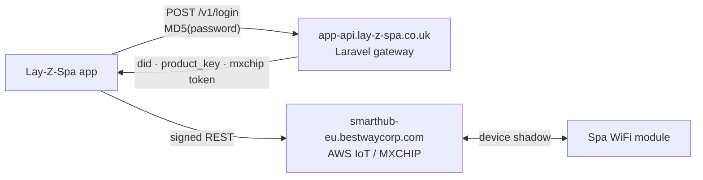

<div align="center">

# 🌊 torronto

**Lay-Z-Spa · full cloud read/write control from the command line**

Reverse-engineered protocol for the **Lay-Z-Spa Toronto AirJet Plus (UltraFit)**
— the piece that had stumped the community since the app's 2024 backend migration.

[](https://www.python.org)
[-brightgreen)](#)
[](#)
[](#)

</div>

---

## ✨ Highlights

| | |
|---|---|
| 🧪 **Reverse-engineered** | Login route, MD5 password quirk, signing scheme — all from `libapp.so` |
| ⌨️ **Full control** | Power, heat, filter, AirJet, HydroJet, lock, target temp |
| 🧩 **Zero dependencies** | Pure Python stdlib, single file (`spa.py`) |
| 🔐 **Cached auth** | Login once, tokens cached — no repeated logins that kill the app session |
| 📡 **Live monitoring** | `watch` polls the cloud shadow and prints on change |

## 🚀 Quick start

```bash
cp secrets.env.example secrets.env   # add your app email + password
python3 spa.py login                 # caches tokens → tokens.json
python3 spa.py status                # live state of the tub
python3 spa.py temp 38               # target temperature
python3 spa.py wave on               # bubbles on 🌊
python3 spa.py watch                 # poll every 15s, print on change
```

## 🕹️ Commands

| Command | Effect |
|---|---|
| `login` | (Re)login, cache tokens |
| `status [--raw]` | Current state (JSON with `--raw`) |
| `watch [--raw] [--interval N]` | Poll every 15s, print on change |
| `power on\|off` | Master power |
| `heat on\|off` | Heater |
| `filter on\|off` | Filter pump |
| `wave on\|off` | AirJet bubbles |
| `jet on\|off` | HydroJet (if equipped) |
| `lock on\|off` | Panel lock |
| `temp <20-40>` | Target temperature (spa's unit) |
| `raw <datapoint> <value>` | Arbitrary datapoint write |
| `ota` | Check for published firmware updates |

## 🗺️ How it works



1. **Login** — `POST /v1/login` with the **MD5 hash** of your password (not the password itself — this was the missing piece).
2. **Identity** — the response carries the spa's `did`, `product_key` and an MXCHIP visitor token.
3. **Data plane** — read via `thing_shadow`, write via `device/command`, every request signed with `sign = UPPERCASE(MD5(appid + appsecret + nonce + ts))`.

<details>
<summary><b>📋 Datapoint reference</b> (click to expand)</summary>

| Datapoint | Read | Write | Meaning |
|---|---|---|---|
| `power_state` | 0/1 | 0/1 | master power |
| `heater_state` | 0–8 | 0/1 | 0 off · 2–3 heating · 4–6 holding · 7–8 winter mode |
| `filter_state` | 0/2 | 0/1 | filter pump (read 2 = running) |
| `wave_state` | 0/1 | 0/1 | AirJet bubbles |
| `hydrojet_state` | 0/1 | 0/1 | HydroJet massage |
| `temperature_setting` | 20–40 | 20–40 | target temp (spa's unit) |
| `temperature_unit` | 1=C, 0=F | – | display unit |
| `water_temperature` | number | – | current water temp |
| `warning` | "1" = at target | – | reached set temperature |
| `error_code` | string | – | pump error code |
| `locked` | 0/1 | 0/1 | panel lock |

Raw registers (`B0–B9`, `P0–P2`, `W0`) remain **undecoded** — a TODO.
</details>

## 📚 Documentation

| File | Contents |
|---|---|
| [`PROTOCOL.md`](PROTOCOL.md) | Full protocol spec — endpoints, auth, signing, payloads |
| [`RESEARCH_LOG.md`](RESEARCH_LOG.md) | Chronological RE session log, incl. all dead ends |
| [`SENSOR_HACK.md`](SENSOR_HACK.md) | Engineering deep-dive: beating the 40°C cap |
| [`COMMUNITY_POST.md`](COMMUNITY_POST.md) | Ready-to-paste writeup for issue #88 |
| [`docs/datapoints-FTEW0E.json`](docs/datapoints-FTEW0E.json) | Official manufacturer datapoint definition |

## ⚠️ Caveats

> [!WARNING]
> **No local API.** The pump has no local network interface — if Bestway's cloud (or your internet) is down, this tool stops working (the panel still works).

> [!CAUTION]
> **Repeated logins invalidate the phone app's session.** Tokens are cached precisely to avoid this — log in once.

> [!IMPORTANT]
> **Unofficial.** Bestway can change or break any of this at any time.

## 🧑‍🤝‍🧑 Credits & prior art

Built on community research — [cdpuk/ha-bestway](https://github.com/cdpuk/ha-bestway) (issue [#88](https://github.com/cdpuk/ha-bestway/issues/88), [our writeup](https://github.com/cdpuk/ha-bestway/issues/88#issuecomment-6233830512)), [gklka/homebridge-layzspa](https://github.com/gklka/homebridge-layzspa), [epheterson/bestway-spa-v2](https://github.com/epheterson/bestway-spa-v2), [M1R4G376/New_bestway_spa](https://github.com/M1R4G376/New_bestway_spa), [andiwirz/homey-lay](https://github.com/andiwirz/homey-lay), and the [Home Assistant thread](https://community.home-assistant.io/t/lay-z-spa-hot-tub-wi-fi-pump-automation/229006).

The novel contributions here: the `app-api.lay-z-spa.co.uk` route map and the MD5 password quirk.

## 🔒 License

[Unlicense](https://unlicense.org) — public domain. See [`LICENSE`](LICENSE).
